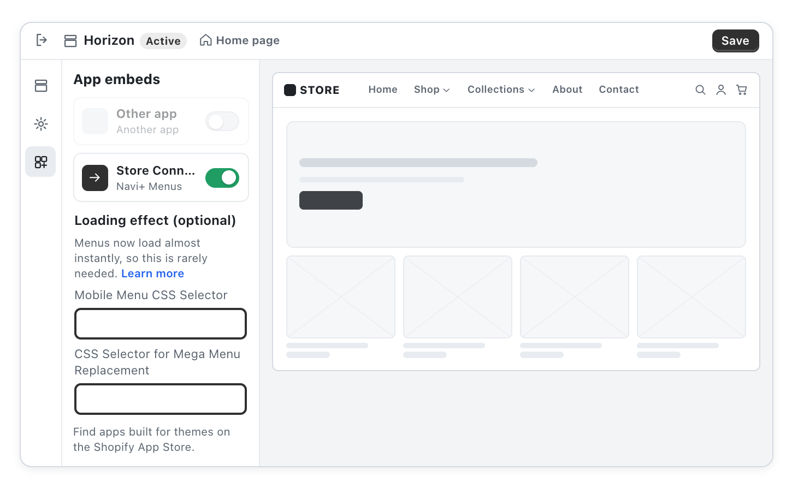
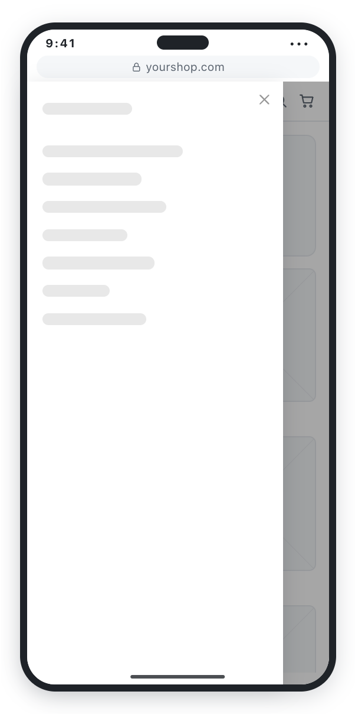
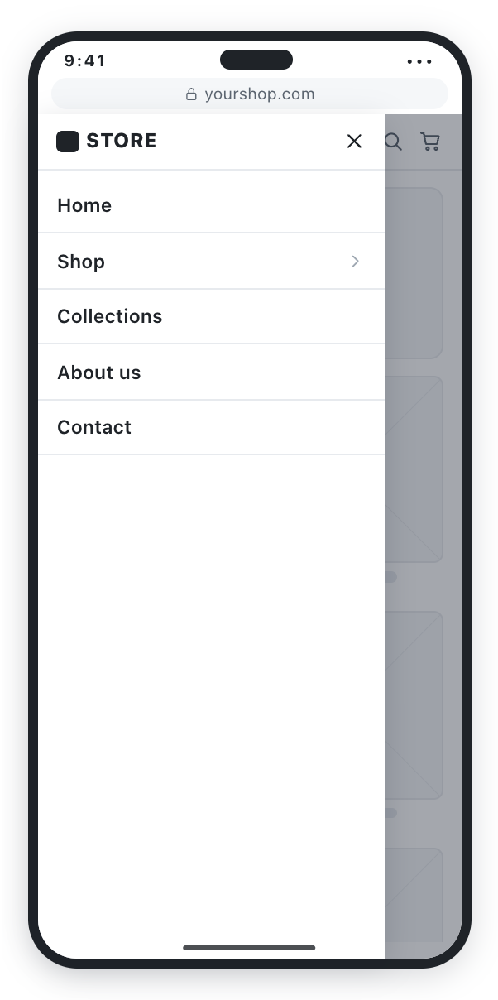
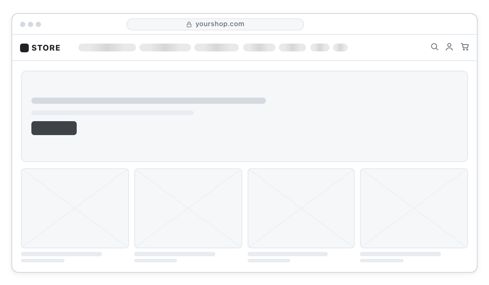
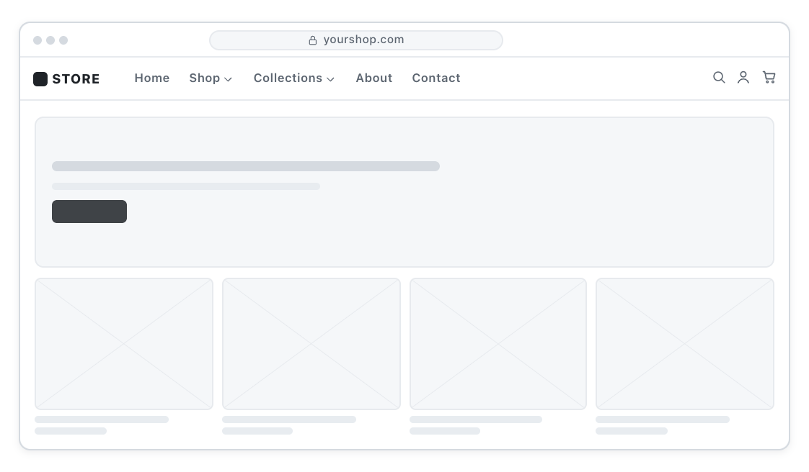

# Add a loading effect (optional)

The loading effect is a grey skeleton that holds the menu's place while Navi+ is still getting ready, so visitors never see an empty gap or your theme's old menu flashing. Since November 5, 2026 Navi+ prints your menu straight into the page, so it shows up almost instantly and you rarely need this.

It only does something for two menus: a **Mobile Menu opened by your theme's own ☰ button**, and a **Mega Menu set to Replace**. In the **Publish** window you will see a line **Add a loading effect (optional)**; click **X** to hide it if you don't need it.

#### How to turn it on

Go to **Theme editor › App embeds › Store Connector**, open **Loading effect (optional)**, paste your CSS selector into the matching field and click **Save**: **Mobile Menu CSS Selector** for a Mobile Menu, **CSS Selector for Mega Menu Replacement** for a Mega Menu.

<figure><figcaption></figcaption></figure>

* Add the suffix **(M)** to apply it only on mobile, **(D)** only on desktop. No suffix means both.
* Leave both fields empty and the menu works as usual.

#### What visitors see

**Mobile Menu.** A visitor taps ☰ while the page is still loading. A skeleton drawer slides in right away (white background, pulsing grey lines), then the real menu takes its place.

<figure><figcaption>While loading</figcaption></figure>

<figure><figcaption>Ready</figcaption></figure>

**Mega Menu (Replace).** Your theme's menu bar becomes a row of grey pills with a light shimmer, holding its place. Then the Navi+ Mega Menu replaces it and the header doesn't jump.

<figure><figcaption>While loading</figcaption></figure>

<figure><figcaption>Ready</figcaption></figure>
